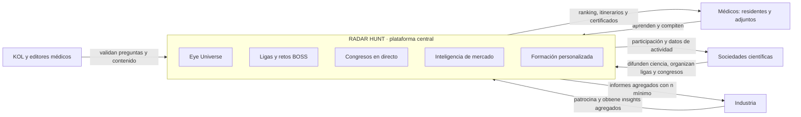
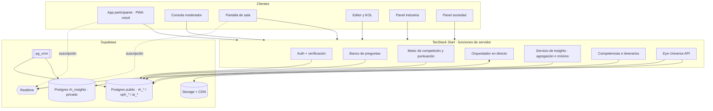
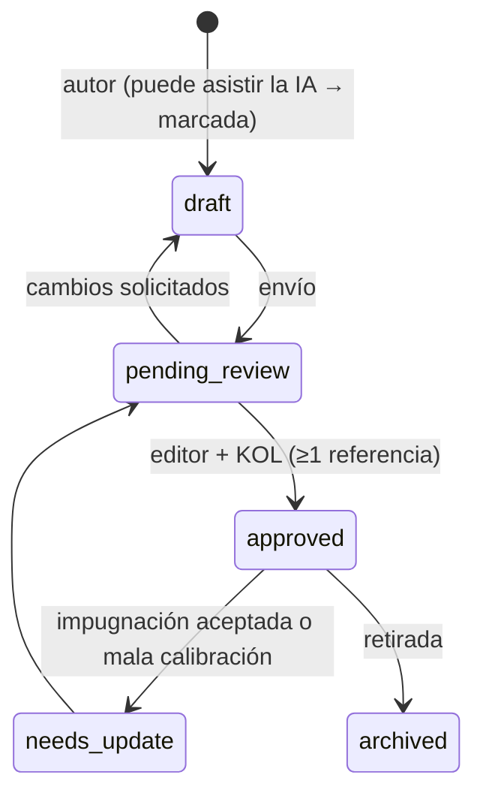

# RADAR HUNT — Arquitectura de la plataforma (v0.1, borrador)

> **Play. Learn. Discover.** Plataforma de competición médica, formación interactiva e inteligencia de mercado en oftalmología, desarrollada por Ophthalmology Radar.
>
> **Estado:** propuesta de arquitectura, 3 nov 2026. No está implementada. Se construye **sobre el motor existente** de Ophthalmology Radar (este repositorio), sin reescribirlo.
>
> **Pendiente de incorporar:** el código y lo aprendido en **radarhunt.app** (activación del congreso NOAPS 2026, Valencia, 5–6 nov), que no está accesible desde este repositorio.

---

## 1. Principios de diseño

1. **La ciencia es la protagonista.** Toda pregunta, caso o contenido pasa por el flujo editorial que ya existe (generado por IA → revisado por OR → validado por KOL) y lleva **referencias verificables**. Nada clínico se publica sin validar.
2. **Dos mundos separados por diseño: competición y mercado.**
   - Las respuestas clínicas (puntuación) y las de mercado (insights) se guardan en **esquemas distintos**, con **identificadores distintos** y **consentimientos distintos**.
   - La industria **nunca** ve respuestas individuales ni puntuaciones.
3. **Privacidad desde el diseño (RGPD):**
   - consentimiento granular;
   - mínimo de participantes por celda en cualquier agregado;
   - seudonimización por estudio;
   - retención limitada;
   - derecho de supresión, que ya existe para los datos de IA y se amplía a Radar Hunt.
4. **Educativo, no asistencial.** Se mantiene el encuadre actual: ni diagnóstico individual, ni posología, ni producto sanitario.
5. **El servidor tiene la autoridad.** Tiempos, puntuación, ventanas de respuesta y clasificaciones se calculan en el servidor; el cliente solo muestra.
6. **Primero el móvil y luego la sala.** En un congreso se participa desde el móvil y se proyecta en pantalla grande.
7. **Español primero y bilingüe.** Interfaz en español por defecto, con todo el contenido en ES/EN, como ya está el catálogo `oph_*`.
8. **Reutilizar antes que construir.** Se aprovechan los roles, las reglas de acceso, el catálogo clínico, el RAG, la analítica, la retención y el CI existentes.

---

## 2. Ecosistema y actores

| Actor | Cómo se modela | Qué puede hacer |
|---|---|---|
| Participante (residente o adjunto) | `auth.users` + `rh_profiles` (etapa profesional y verificación) + rol `verified_doctor` | Jugar ligas, retos y congresos; ver su progreso e itinerarios |
| Editor médico / KOL | Roles existentes `medical_editor` y `kol` | Crear, revisar y validar preguntas y casos; resolver impugnaciones |
| Sociedad científica | `rh_organizations` (tipo `society`) + `rh_org_members` | Organizar ligas y congresos y ver la actividad de sus socios (agregada) |
| Organizador o moderador de congreso | `rh_org_members` (rol `moderator`) por evento | Lanzar retos y encuestas en directo y controlar la pantalla de sala |
| Industria o patrocinador | Rol existente `industry_user` + `rh_organizations` (tipo `sponsor`) | Patrocinar con transparencia; encargar estudios; ver **solo agregados** |
| Administrador de plataforma | Rol existente `admin` | Todo, con auditoría |

**Decisión clave:**
- **Residente o adjunto** es un **atributo del perfil**, no un rol, porque determina en qué liga compite cada uno.
- **Los roles de organización** (sociedad, patrocinador, moderador) van **por organización** (`rh_org_members`), porque un mismo usuario puede ser socio de una sociedad y moderador en un congreso.

---

## 3. Mapa de módulos (dominios)

| # | Dominio | Pilar | Estado | Base existente que se reutiliza |
|---|---|---|---|---|
| D1 | Identidad, verificación profesional y organizaciones | Todos | Nuevo (parcial) | `or_ai_user_roles`, auth y middleware |
| D2 | Contenido científico (atlas, evidencia, RAG, tutor) | 5 | **Existe** | Todo `oph_*`, `ai_*`, editorial |
| D3 | Banco de preguntas y casos BOSS | 2 y 3 | Nuevo | Flujo editorial, `oph_references`, `oph_anatomical_sites` |
| D4 | Competición (temporadas, ligas, rondas, puntuación, clasificaciones, finales) | 2 | Nuevo | — |
| D5 | Congresos en directo (eventos, sesiones, retos y encuestas en vivo, pantalla de sala) | 3 | Nuevo (radarhunt.app puede tener parte) | Supabase Realtime |
| D6 | Inteligencia de mercado (estudios, consentimientos, respuestas seudónimas, agregación) | 4 | Nuevo | Retención RGPD, analítica |
| D7 | Formación personalizada (mapa de competencias e itinerarios) | 5 | Nuevo | RAG + tutor (`academy-tutor`), contenido aprobado |
| D8 | Eye Universe (capítulos interactivos ahora; 3D más adelante) | 1 | Nuevo | Película máster v4, insertos S02P/S02Z/S03D/S04C |
| D9 | Patrocinio y transparencia | 3 y 4 | Nuevo | — |
| D10 | Gobernanza, auditoría y cumplimiento | Todos | Ampliación | `ai_source_audit`, retención, cuotas |

---

## 4. Arquitectura técnica

### 4.1 Stack (se mantiene el actual)

| Capa | Tecnología | Uso en Radar Hunt |
|---|---|---|
| Frontend y SSR | TanStack Start (React 19, rutas por archivo) + Tailwind + Radix | App de participante (PWA, primero el móvil), consola de moderador, pantalla de sala y paneles de sociedad e industria |
| Lógica de servidor | Funciones de servidor de TanStack con middleware de autenticación | **Toda** la puntuación, las ventanas de respuesta, la entrega de preguntas y las agregaciones |
| Datos | Supabase Postgres + RLS | Esquema `public` (prefijo `rh_`) para competición y contenido; esquema **privado `rh_insights`** (no expuesto por API) para mercado |
| Tiempo real | Supabase Realtime (Broadcast + Presence) | Estado de la sesión en directo, contadores de respuestas y clasificación en vivo |
| Archivos | Supabase Storage + CDN | Imágenes de casos, logotipos y vídeo (ver 4.4) |
| IA | Pasarela de IA existente (chat + embeddings), RAG con pgvector | Ayuda a redactar preguntas (siempre «borrador IA»), explicaciones y recomendación de itinerarios |
| Trabajos programados | `pg_cron` (ya en uso para retención) | Cierre de rondas, recálculo de clasificaciones, calibración de preguntas y agregados de estudios |
| Observabilidad | Logs de servidor + `rh_audit_log` + métricas | Auditoría de acciones sensibles y métricas de congreso en directo |

### 4.2 Vista de componentes

### 4.3 Congreso en directo: flujo y capacidad

1. **Acceso:** el asistente escanea el QR de la sala (`/e/{codigo}`), inicia sesión o se registra rápido y queda vinculado al evento (`rh_event_participants`).
2. **Moderador:** lanza un reto. Una función de servidor cambia `rh_live_state.phase` a `question_open` y fija `phase_ends_at` con la hora del servidor.
3. **Difusión:** Realtime emite al canal `event:{id}:session:{id}` **solo el cambio de fase**, nunca la respuesta correcta.
4. **Pregunta:** el móvil pide el enunciado a una función de servidor, que **solo lo entrega si la fase está abierta**. Las opciones llegan en un orden aleatorio por usuario.
5. **Respuesta:** va por una función de servidor, que valida la ventana, mide el tiempo **en el servidor**, puntúa y guarda en `rh_answers`.
6. **Recuento:** el contador agregado se emite como mucho cada 500 ms, para la pantalla de sala.
7. **Revelación:** fase `reveal` (respuesta correcta + explicación con referencia), seguida de `leaderboard`.
8. **Encuestas de opinión de sala:** son de la sesión y **no** de mercado. Si una encuesta debe servir como insight para la industria, se crea como **estudio de D6** con su propio consentimiento.

**Capacidad objetivo:** 2.000 participantes simultáneos por evento, 300–800 respuestas en los 20 s de una pregunta y menos de 1 s del cierre a la pantalla. **A verificar** antes del primer congreso: los límites de Realtime y conexiones del plan de Supabase contratado, más una **prueba de carga** (k6) con el patrón real.

**Medidas contra trampas:**
- la pregunta solo se entrega en la fase abierta;
- el reloj es el del servidor;
- un dispositivo activo por intento;
- límite de peticiones;
- se marcan los patrones anómalos (respuestas sistemáticas en menos de 800 ms);
- orden de opciones aleatorio.

### 4.4 Eye Universe

**Fase actual: película interactiva por capítulos (2D).**
- **Vídeo:** el máster v4 se convierte a **HLS** con escalera 2160/1440/1080/720/480 a partir del ProRes y se sirve por CDN. Hay que decidir entre Supabase Storage + CDN, Cloudflare Stream o Mux.
- **Capítulos** (`rh_eye_chapters`, tiempos aproximados que se fijarán al fotograma con `build_v4_all.ps1`):

| Capítulo | Tramo (s) | Estructura | Subespecialidades enlazadas |
|---|---|---|---|
| S01 Puerta corneal | 0,0–9,0 | Córnea, epitelio, estroma, endotelio | cornea, ocular_surface, contactology, refractive |
| S02A Iris y pupila | 9,0–13,0 | Iris, collarete, pupila | uveitis, glaucoma |
| S02P Reflejo fotomotor | 13,0–16,75 | Esfínter y vía pupilar | neuro_ophthalmology |
| S02Z Zónula y acomodación | 16,75–22,25 | Cuerpo ciliar, zónula, ángulo | cataract, refractive, glaucoma |
| S02 Cristalino | 22,25–28,0 | Cápsula, córtex, núcleo | cataract |
| S03 Vítreo | 28,0–37,0 | Vítreo y polo posterior | retina |
| S04 Mácula | 37,0–43,0 | Mácula, disco y vasos | retina |
| S04C Capas de la retina | 43,0–46,0 | Corte foveal | retina |
| S04D Fóvea | 46,0–49,0 | Fóvea | retina |

- **Puntos interactivos** (`rh_eye_hotspots`): por tiempo y posición normalizada. Abren una patología del atlas, una fuente de conocimiento, un **reto relacionado** o una **liga de esa subespecialidad**. Así el ojo se convierte en la **puerta de entrada** a todo el contenido.

**Fase 3D (visión).**
- Modelo glTF segmentado por estructuras con WebGL (three.js), niveles de detalle y carga progresiva.
- Las mismas entidades (`rh_eye_chapters` y `rh_eye_hotspots`) se reutilizan como «nodos» del ojo 3D, así que el modelo de datos no cambia.
- Requiere validación anatómica por un oftalmólogo, igual que la película.

---

## 5. Modelo de datos (resumen)

> Borrador SQL completo en [`modelo-datos-rh_v0.sql`](./modelo-datos-rh_v0.sql), **no aplicado**. Reutiliza `oph_subspecialty`, `oph_content_status`, `oph_references`, `oph_anatomical_sites`, `oph_pathologies` y `or_ai_user_roles`.

| Grupo | Tablas | Notas |
|---|---|---|
| Identidad | `rh_profiles`, `rh_verification_requests`, `rh_organizations`, `rh_org_members` | Etapa profesional (residente o adjunto) y estado de verificación |
| Banco de preguntas | `rh_questions`, `rh_question_options`, `rh_question_references`, `rh_question_reviews`, `rh_question_flags`, `rh_cases`, `rh_case_steps` | Una pregunta solo se activa si está `approved`, tiene ≥1 referencia y nivel `or_reviewed` o `kol_verified` |
| Competición | `rh_seasons`, `rh_leagues`, `rh_league_entries`, `rh_rounds`, `rh_round_items`, `rh_attempts`, `rh_answers`, `rh_leaderboard_entries`, `rh_badges`, `rh_user_badges` | Una ronda pertenece a una liga **o** a una sesión de congreso |
| Congresos | `rh_events`, `rh_event_sessions`, `rh_event_participants`, `rh_live_state`, `rh_polls`, `rh_poll_votes` | `rh_live_state` es la única fuente de verdad de la fase en directo |
| Patrocinio | `rh_sponsorships` | Texto de transparencia obligatorio |
| Mercado (**esquema privado**) | `rh_insights.studies`, `.study_items`, `.consents`, `.respondents`, `.responses` | Sin `user_id` en las respuestas: clave seudónima por estudio |
| Formación | `rh_competency`, `rh_learning_paths` | Calculado a partir de las respuestas de competición |
| Eye Universe | `rh_eye_chapters`, `rh_eye_hotspots` | Común a la película y al 3D |
| Auditoría | `rh_audit_log` | Acciones sensibles: puntuaciones, exportaciones, estudios, verificaciones |

---

## 6. Calidad científica del banco de preguntas

**Ciclo de vida:**

**Metadatos obligatorios:**
- subespecialidad;
- nivel (residente, adjunto o ambos);
- dificultad declarada (1–5);
- nivel cognitivo (recordar, comprender, aplicar, analizar);
- estructura anatómica;
- explicación ES/EN;
- **≥1 referencia** (`oph_references`, con DOI/PMID o guía AAO/EGS/EURETINA/TFOS/NICE…).

**Calibración tras ≥200 respuestas:**
- índice de dificultad *p* y discriminación (correlación punto-biserial);
- se marca para revisión si *p* > 0,95, si *p* < 0,15 o si la discriminación < 0,10;
- más adelante, TRI (2PL) para dificultad real y pruebas adaptativas.

**Impugnaciones:** el participante impugna (`rh_question_flags`). Si el KOL la acepta, se anula la pregunta para todos en esa ronda y se recalcula la clasificación, con auditoría.

**La IA ayuda, pero no decide.** Puede proponer borradores, distractores y explicaciones, siempre con `ai_assisted = true` y a partir de fuentes del corpus. **Nunca** se activa sin validación humana. Se reutiliza la verificación de citas existente para descartar referencias inventadas.

---

## 7. Puntuación y clasificaciones

**Por pregunta** (en el servidor):

- `puntos = base(d) × acierto × (1 + λ · max(0, 1 − t/T))`
- `base(d) = 100 · (1 + 0,25 · (d − 1))`, con dificultad *d* = 1…5. Como esta *d* no está calibrada al principio, se usa la declarada y luego la calibrada.
- `λ = 0,5`: la rapidez aporta como mucho un +50 % y nunca supera al acierto.
- *t* es el tiempo medido en el servidor desde que se entrega la pregunta, menos un margen de latencia de 300 ms; *T* es el límite de tiempo.
- **Selección múltiple:** crédito parcial `max(0, (aciertos − falsos) / correctas)`.
- **Reto BOSS** (caso en varios pasos): suma de los pasos + bonus del 20 % si el caso entero se resuelve sin error. Cada paso revela información nueva, como en la consulta real.

**Por liga:** suma de las **mejores N de M rondas**, para no castigar una guardia. **Desempate:** aciertos, luego tiempo total y luego la fecha de la última respuesta.

**Finales:** los K primeros de cada liga (residentes y adjuntos por separado) pasan a la final, que puede jugarse en directo en un congreso.

**Visibilidad:**
- en la clasificación pública el participante aparece con **alias** o nombre, a su elección;
- puede no salir en público y competir igualmente;
- las sociedades ven a sus socios; la industria **no ve clasificaciones individuales**.

**Gamificación sobria:** insignias por constancia y dominio de una subespecialidad, y certificados de participación. Si en el futuro se buscan **créditos de formación médica continuada**, hay que acreditarlos (por ejemplo SEAFORMEC o EACCME): **a valorar**.

---

## 8. Inteligencia de mercado (pilar 4): cómo se protege la confianza

1. **Estudio** (`rh_insights.studies`): lo encarga un patrocinador y lo aprueba Ophthalmology Radar, revisando objetivo, preguntas y que no haya promoción encubierta.
2. **Consentimiento propio** por estudio: claro, voluntario, revocable y **sin efecto en la puntuación ni en el acceso**.
3. **Seudonimización:** el participante se registra en `rh_insights.respondents` con `respondent_key = HMAC(user_id, secreto_del_estudio)`. Las respuestas **no tienen `user_id`**. Del perfil solo se copia un **segmento grueso** (etapa profesional, país, subespecialidad principal, tramo de años de experiencia).
4. **Agregación con n mínimo y publicación controlada.**
   - Los analistas internos usan `rh_insights_aggregate(...)`, que solo devuelve celdas con n ≥ `min_cell_size` (20 por defecto, configurable por estudio).
   - La industria **no consulta libremente**: solo lee **tablas publicadas** (`rh_insights.released_tables`, a través de `rh_insights_released`), que un analista prepara con **supresión complementaria** y aprueba.
   - **Por qué:** en la prueba del borrador (3 nov) se comprobó que la supresión por celda no basta. Con una consulta sin segmentar y otra segmentada se deducían por diferencia las celdas ocultas (27 «sí» en total − 22 de residentes = 5 de adjuntos, un segmento suprimido), y el porcentaje revelaba el resto del segmento.
5. **Texto libre:** nunca se entrega tal cual. Primero se resume o categoriza por un editor (o con IA y revisión humana), sin citas identificables.
6. **Informe:** agregado, con tamaño de muestra, sesgos y límites declarados (participantes voluntarios, no representativos de la población).
7. **Retención:** las respuestas seudónimas se borran o anonimizan al cerrar el estudio y entregar el informe, en el plazo a fijar.

**A validar con asesoría legal** antes de abrir el pilar 4:
- **RGPD:** quién es responsable y quién encargado, base jurídica, información y DPA con el proveedor de IA.
- **Códigos de la relación entre la industria y los profesionales** (en España, el Código de Buenas Prácticas de Farmaindustria; en Europa, EFPIA y MedTech Europe): **independencia científica** del contenido, **transparencia** del patrocinio y **límites a premios e incentivos** a profesionales sanitarios.

---

## 9. Formación personalizada (pilar 5)

1. **Mapa de competencias** (`rh_competency`) por usuario y subespecialidad, con estimación de habilidad e incertidumbre. Al principio es una puntuación tipo Elo actualizada con cada respuesta; luego, TRI.
2. **Detección de áreas de mejora:** subespecialidad, estructura anatómica y nivel cognitivo donde el rendimiento está por debajo de lo esperado.
3. **Itinerarios** (`rh_learning_paths`): contenido **solo aprobado** (atlas, fuentes validadas, capítulos del Eye Universe, retos de práctica), elegido con el RAG existente y explicado por el tutor. Cada recomendación justifica el porqué («fallos en clasificación de OCT macular»).
4. **Sin decisiones automatizadas con efectos significativos:** es orientación formativa y el usuario la ve, la controla y puede borrarla.

---

## 10. Seguridad y cumplimiento (además de lo ya hecho en P0–P2)

| Riesgo | Medida |
|---|---|
| Acceso indebido a datos | RLS en todas las tablas `rh_*`; esquema `rh_insights` sin permisos para `anon` ni `authenticated` (solo funciones `security definer` con control de rol y n mínimo) |
| Trampas en competición | Lógica en servidor, reloj del servidor, entrega por fases, límite de peticiones y detección de anomalías |
| Suplantación profesional | Verificación por número de colegiado o institución, más revisión manual; nivel «verificado» obligatorio para ligas oficiales y estudios |
| Fugas hacia la industria | Ninguna exportación individual; sin consulta libre (solo tablas publicadas con supresión primaria y complementaria); auditoría de cada agregado |
| Contenido clínico erróneo | Flujo editorial + KOL, referencias obligatorias, impugnaciones y calibración |
| Datos personales | Minimización, retención con `pg_cron`, supresión de autoservicio ampliada a `rh_*` y registro de consentimientos |
| Patrocinio opaco | Texto de transparencia obligatorio en cada inserción patrocinada; contenido científico separado del patrocinado |

---

## 11. Integración con lo existente y con radarhunt.app

- **Este repositorio (motor):** se añaden los módulos `rh_*` y las rutas de Radar Hunt. Lo actual de Ophthalmology Radar (atlas, IA clínica, editorial…) queda dentro, como «Conocimiento».
- **radarhunt.app (en producción para NOAPS):** **no se toca antes del congreso**. Después, hay tres opciones según su código:
  - **A.** Si es de la misma familia tecnológica (Lovable / TanStack / Supabase), se fusiona en este repositorio y se mantiene el dominio.
  - **B.** Si es otra tecnología, sigue como portada pública y se conecta a este motor por API, migrando por fases.
  - **C.** Si solo es una landing, se rehace aquí con la nueva marca.
- **Navegación objetivo:**

| Área | Rutas | Acceso |
|---|---|---|
| Pública | Inicio, Eye Universe, Ligas (información), Congresos, Para sociedades, Para la industria | Sin cuenta |
| Participante | Mi Radar (progreso), Jugar (rondas y BOSS), Clasificaciones, Mis congresos, Itinerario, Conocimiento (atlas y tutor actuales) | Con cuenta |
| Editorial | Banco de preguntas, Revisión y KOL, Impugnaciones, Calibración (más lo editorial actual) | Editores y KOL |
| Organización | Mis ligas y eventos, Consola de moderador, Pantalla de sala, Actividad agregada | Sociedades y organizadores |
| Industria | Estudios, Resultados agregados, Patrocinios | Industria |
| Administración | Usuarios y verificación, Organizaciones, Ajustes, Auditoría, Estado del sistema | Administradores |

---

## 12. Hoja de ruta por fases

Tamaño relativo: S = pequeño, M = medio, L = grande. Las fechas se fijarán tras ver radarhunt.app y lo aprendido en NOAPS.

| Fase | Contenido | Tamaño | Criterio de salida |
|---|---|---|---|
| **0 · NOAPS** (5–6 nov) | No tocar producción. Recoger métricas, preguntas usadas, incidencias y peticiones de patrocinadores | S | Informe post-congreso |
| **1 · Cimientos** | Marca y sistema de diseño Radar Hunt (español primero), perfiles + verificación, organizaciones, nueva navegación, **Eye Universe interactivo por capítulos** (HLS + capítulos + puntos interactivos) | M | Usuario verificado navega el ojo y llega al atlas desde cada capítulo |
| **2 · Banco + Ligas** | Banco de preguntas con flujo KOL, casos BOSS, temporadas, ligas residente/adjunto, rondas asíncronas, puntuación, clasificaciones, impugnaciones | L | Una liga piloto (1 subespecialidad, ≥100 preguntas validadas) jugada de principio a fin |
| **3 · Congreso en directo** | Acceso QR, consola de moderador, pantalla de sala, retos y encuestas en vivo, patrocinio transparente y prueba de carga | M–L | Simulacro con ≥500 usuarios sintéticos y menos de 1 s de latencia |
| **4 · Insights** | Estudios, consentimientos, respuestas seudónimas, agregación con n mínimo e informes | M | **Visto bueno legal** + primer estudio piloto entregado |
| **5 · Personalización** | Mapa de competencias, itinerarios y tutor conectado a resultados | M | Recomendaciones visibles y justificadas para usuarios con ≥30 respuestas |
| **6 · Eye Universe 3D** | Ojo 3D navegable (glTF/WebGL) con los mismos nodos | L | Validación anatómica por un oftalmólogo |

**Cuello de botella real: el contenido, no el código.** Una liga necesita cientos de preguntas validadas con referencias. Hay que planificar desde ya la capacidad de los KOL (preguntas por semana y por subespecialidad). Además siguen pendientes las **186 monografías en borrador** del motor actual.

---

## 13. Métricas de éxito

| Grupo | Métricas |
|---|---|
| Participación | Usuarios verificados activos al mes, retención a 30 y 90 días, rondas completadas por usuario y temporada |
| Congresos | % de asistentes que participan, respuestas por pregunta, latencia en la sala, NPS del asistente |
| Calidad científica | % de preguntas validadas por KOL, tasa de impugnaciones aceptadas, % de preguntas bien calibradas |
| Aprendizaje | Mejora de la habilidad por subespecialidad entre temporadas; % de itinerarios iniciados y completados |
| Industria y sociedades | Estudios entregados, tasa de respuesta y de consentimiento, renovación de patrocinios, eventos por sociedad |

---

## 14. Riesgos principales

| Riesgo | Impacto | Mitigación |
|---|---|---|
| Falta de preguntas validadas | Alto | Plan de capacidad de KOL, borradores asistidos por IA y empezar con una subespecialidad |
| Encaje legal de insights y premios | Alto | Visto bueno legal antes de la fase 4 y del primer premio patrocinado |
| Duplicar lo que ya hace radarhunt.app | Medio | Revisar su código antes de la fase 2 |
| Tiempo real a escala de congreso | Medio | Prueba de carga y límites del plan antes del primer evento |
| Fricción en la verificación profesional | Medio | Verificación rápida (correo institucional o colegiado) + manual; jugar en modo práctica sin verificar |
| Ambición del 3D | Medio | El 2D interactivo da el valor ya; el 3D va en una fase aparte |

---

## 15. Decisiones abiertas

1. **radarhunt.app:** dónde está su código y qué cubre hoy (cuentas, retos, patrocinadores).
2. **Verificación profesional:** métodos por país (número de colegiado en España, correo institucional, carné de sociedad).
3. **Premios y patrocinio:** política de premios compatible con los códigos del sector.
4. **Vídeo:** Supabase Storage + CDN, Cloudflare Stream o Mux.
5. **Parámetros de puntuación:** λ, N de M rondas y K finalistas.
6. **n mínimo** por celda en los insights (20 propuesto).
7. **Alojamiento:** Lovable Cloud, Railway, Vercel u otro (decisión aplazada por el usuario).
8. **Primera liga piloto:** subespecialidad y sociedad socia.
